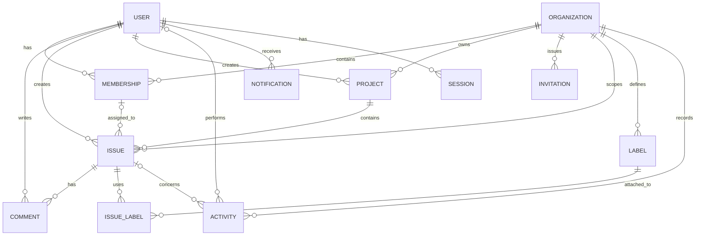

**Project:** Multi-Tenant Project Management API  
**Workflow Stage:** 03 — Design  
**Document:** 09  
**Version:** 1.0  
**Status:** Approved

---

# Conceptual and Logical ERD v1

This document defines the conceptual and logical ERD for Domain Specification v1 in Workflow Stage 03: Design.

Keep one principle in mind before looking at the diagrams: a domain entity does not automatically become one table, and each table does not automatically represent one business concept. The database is a storage model that must preserve domain rules, not a raw copy of a list of nouns.

## 1. Finalize the Domain Model

We retain the original scope: one multi-tenant application, multiple Organizations, Members with different roles per Organization, Projects, Issues, Comments, Labels, and history.

Before creating the diagrams, the following decisions are established for v1:

| Area | v1 decision |
|---|---|
| User | Global identity, not tied to one Organization |
| Membership | User–Organization relationship with role and status |
| Organization | No archival lifecycle is defined for v1 |
| Project | Belongs to exactly one Organization; key is unique within that Organization |
| Issue | Belongs to exactly one Project; cannot be moved between Organizations |
| Assignee | Optional; must be an active Member of the relevant Organization |
| Label | Belongs to one Organization and can be used by multiple Issues in that same Organization |
| Comment | Associated with an Issue and its author |
| Activity | Append-only history |
| Invitation | Has its own expiry and lifecycle |
| Session | User authentication session, separate from Membership |

Domain decisions established in Requirements are the source of truth for the ERD. An Organization has no archive/delete lifecycle in v1; Comments use soft deletion; and Notifications are not sent to Users who are no longer Members of the Organization.

## 2. Conceptual ERD

A conceptual ERD shows business entities and relationships without considering PostgreSQL implementation details.



How to read it:

- `USER ||--o{ MEMBERSHIP`: every Membership has exactly one User, while a User may have zero or many Memberships.
- `ORGANIZATION ||--o{ PROJECT`: every Project must belong to one Organization; an Organization may have no Projects yet.
- `ISSUE ||--o{ COMMENT`: every Comment is associated with exactly one Issue.
- `ISSUE` and `LABEL` are connected through `ISSUE_LABEL` because their relationship is many-to-many.
- `MEMBERSHIP o|--o{ ISSUE`: the Assignee relationship is optional on an Issue; one Membership may be assigned to many Issues.

This diagram describes relationships, not the complete security rules. An ERD alone cannot guarantee that an Assignee belongs to the correct Organization or that the last Owner cannot leave.

## 3. Logical ERD: Introduce Tables

We now derive the relationships into a relational structure. At this point, we begin discussing primary keys, foreign keys, and constraints.

### Identity and Organization

| Table | Main columns | Important constraints |
|---|---|---|
| `users` | `id`, `email`, `name`, `password_hash`, `created_at` | Email unique after normalization |
| `organizations` | `id`, `name`, `slug`, `created_at` | Slug globally unique in v1 |
| `memberships` | `id`, `user_id`, `organization_id`, `role`, `status`, `joined_at`, `removed_at?` | `UNIQUE(user_id, organization_id)`; a `REMOVED` Membership is reactivated on re-invitation |
| `invitations` | `id`, `organization_id`, `invited_email`, `invited_by`, `role`, `token_hash`, `expires_at`, `accepted_at`, `status` | Unique token hash; partial unique index on `(organization_id, lower(invited_email))` where `status = PENDING` |

Several design decisions here are important.

Why does Membership have its own `id`? We could use the pair `(user_id, organization_id)` as a composite primary key. However, this project uses a surrogate `id` and a unique constraint on that pair to simplify references and ORM usage.

Why does Invitation store `invited_email` instead of `user_id`? The invited person may not have an account yet. Only after the Invitation is accepted does the system associate them with a User through Membership.

Why store `token_hash`? The actual Invitation token acts like a credential. Storing its hash reduces the impact of a table leak.

### Project and Issue

| Table | Main columns | Important constraints |
|---|---|---|
| `projects` | `id`, `organization_id`, `name`, `key`, `description`, `created_by`, `next_issue_number`, `archived_at?`, `created_at`, `updated_at` | `UNIQUE(organization_id, key)` |
| `issues` | `id`, `organization_id`, `project_id`, `number`, `title`, `description`, `status`, `priority`, `assignee_membership_id?`, `created_by`, `version`, `archived_at?`, `created_at`, `updated_at` | `UNIQUE(project_id, number)`; composite tenant FKs; `version > 0` |

Three different kinds of identifiers:

```text
Internal ID      = 7f...a2
Project key      = PAY
Issue number     = 431
Display ID       = PAY-431
```

`id` is the internal identity. `key` is the Project's business identifier. `number` is the Issue number within the Project. `PAY-431` is formed from the last two values.

With this design, Acme and Beta may both have a Project with key `PAY`, and each Project may have an Issue numbered `431`.

### Collaboration and History

| Table | Main columns | Important constraints |
|---|---|---|
| `comments` | `id`, `issue_id`, `author_id`, `body`, `created_at`, `updated_at`, soft-delete state | `issue_id` and `author_id` are required |
| `labels` | `id`, `organization_id`, `name` | Name unique per Organization |
| `issue_labels` | `issue_id`, `label_id` | `PRIMARY KEY(issue_id, label_id)` |
| `activities` | `id`, `organization_id`, `actor_id?`, `issue_id?`, `action`, `metadata`, `created_at` | Append-only; actor may be null for system actions |
| `notifications` | `id`, `user_id`, `type`, `payload`, `read_at`, `created_at` | Only the Notification owner may read it |
| `sessions` | `id`, `user_id`, `token_hash`, `expires_at`, `revoked_at`, `created_at` | Unique token hash |

`activities` is intentionally Organization-oriented, with an optional `issue_id`. This allows Membership changes to be recorded without pretending that every event is an Issue change.

The consequence is that any relationship among `organization_id`, `issue_id`, and a possible future `project_id` must remain consistent. We address this in constraint design and the application layer rather than assuming that several ordinary foreign keys automatically guarantee that all references belong to the same tenant.

## 4. What Should Be Enforced by the Database vs the Application?

This is one of the most important logical-design decisions.

| Rule | Primary enforcement |
|---|---|
| User email is unique | Database unique constraint |
| Membership is not duplicated | Database unique constraint |
| Project key is unique per Organization | Database composite unique constraint |
| Issue number is unique per Project | Database composite unique constraint |
| Issue must have a Project | Foreign key + `NOT NULL` |
| Assignee is an active Member of the correct tenant | Membership relationship + status and tenant validation |
| Status changes only through valid transitions | Domain/application logic |
| Organization always has at least one Owner | Application logic + transaction and concurrency control |
| Activity cannot be modified | Database permissions or trigger, plus application policy |
| Issue version cannot suffer a lost update | Atomic conditional update |
| Resources from another tenant cannot be accessed | Server-side authorization; additional constraints where needed |

Remember that PostgreSQL `CHECK` constraints are not suitable for rules that require checking multiple rows or tables. For example, a simple `CHECK` cannot guarantee that an Organization always has at least one active Owner.

## 5. Important Refinement: Assignee Should Reference Membership

An earlier draft used `issues.assignee_id` pointing to User. The final decision uses `issues.assignee_membership_id` pointing to Membership. A revoked Membership remains stored with `status = REMOVED`; all Issues assigned to it are unassigned in the same revocation transaction.

Consider this alternative:

```text
issues.assignee_membership_id
             │
             ▼
         memberships
             │
             ├── user_id
             ├── organization_id
             └── status
```

Assignment therefore points conceptually to a User's Membership in an Organization, not merely to the global User identity.

Benefits:

- Organization context is clearer.
- The system can validate Membership status.
- When a Membership is revoked, Issues assigned to that Membership can be unassigned consistently.

A foreign key alone does not guarantee that a Membership is active. Status validation is still required, and revocation must preserve consistency transactionally.

For this project, I recommend nullable `assignee_membership_id`. It better matches the domain than storing a User as Assignee without tenant context.

## 6. Documentation Outputs

Update `docs/domain-model.md` with the clarified relationships and cardinalities. Put the established invariants in `docs/business-rules.md`. Then create `docs/database-design.md` to record:

- Tables and columns.
- Primary and foreign keys.
- Unique constraints and indexes.
- Tenant-isolation rules.
- Transaction boundaries.
- Concurrency strategy.
- Open decisions.

The next step is to refine the logical ERD into a concrete PostgreSQL design. We will establish data types, composite constraints for tenant isolation, soft-deletion or archival strategies, and indexes based on actual query patterns. After that, we can design the API Contract before implementation.

Do not start creating all tables blindly. We want a design that guarantees business rules, not merely a database that accepts data.

---

## 7. Reconciliation with Final Domain Decisions

### 7.1 Conceptual ERD corrections

- The Assignee relationship is **Membership → Issue**, not User → Issue. Membership expresses the Organization context in which the User is assigned. `assignee_membership_id` is nullable.
- Issue has an explicit relationship to both Organization and Project. The Project must belong to the same Organization.
- Activity is an Organization-level event. `actor_id` and `issue_id` are nullable; there is no direct Activity → Project relationship. Project context is stored in metadata when relevant.
- Invitation has the lifecycle `PENDING`, `ACCEPTED`, `REVOKED`, `EXPIRED`.
- Comment has a soft-delete state.
- Project and Issue have an archive state separate from the Issue workflow status; the logical model uses nullable `archived_at` for both.

### 7.2 Logical ERD corrections

| Table | Required logical attributes / constraints |
|---|---|
| `issues` | `organization_id NOT NULL`, `project_id NOT NULL`, nullable `assignee_membership_id`; composite FK `(project_id, organization_id)` to Project; composite FK `(assignee_membership_id, organization_id)` to Membership |
| `memberships` | Unique `(user_id, organization_id)` and unique `(id, organization_id)` for composite references |
| `projects` | Unique `(id, organization_id)` for composite references; unique `(organization_id, key)` |
| `activities` | `organization_id NOT NULL`, `actor_id NULL`, `issue_id NULL`; append-only |
| `comments` | Soft-delete marker/state; no full version history in v1 |
| `invitations` | Four-state `status`, authoritative `expires_at`, unique token hash, partial unique expression index on `(organization_id, lower(invited_email))` where `status = PENDING` |
| `labels` / `issue_labels` | Organization scope and composite references ensuring Issue and Label share an Organization |

The selected v1 persistence representation is nullable `archived_at` on Project and Issue, and nullable `deleted_at` on Comment. The conceptual ERD still shows lifecycle state without depending on column-type details.

### 7.3 Final Issue transition reference

`TODO → IN_PROGRESS/CANCELLED`; `IN_PROGRESS → IN_REVIEW/CANCELLED`; `IN_REVIEW → IN_PROGRESS/DONE/CANCELLED`; `DONE → IN_PROGRESS`; `CANCELLED → TODO`.

### 7.4 Scope guard

The ERD does not define permission policy or API error responses; those are established in the Permission Matrix and API Contract. Email retries, Activity metadata, Issue search, and Issue numbering are established in PostgreSQL Database Design. Locking strategy for the last-Owner invariant remains a database/application implementation detail that must be verified through transactions and concurrency tests.

### 7.5 Issue number allocation

`projects.next_issue_number` is a per-Project persistence counter, uses an integer, and starts at 1. Create Issue obtains the number through an atomic update on the Project row in the same transaction as the Issue and Activity inserts. `UNIQUE(project_id, number)` remains mandatory as an integrity safeguard. The counter must not be sent or modified by the client.
